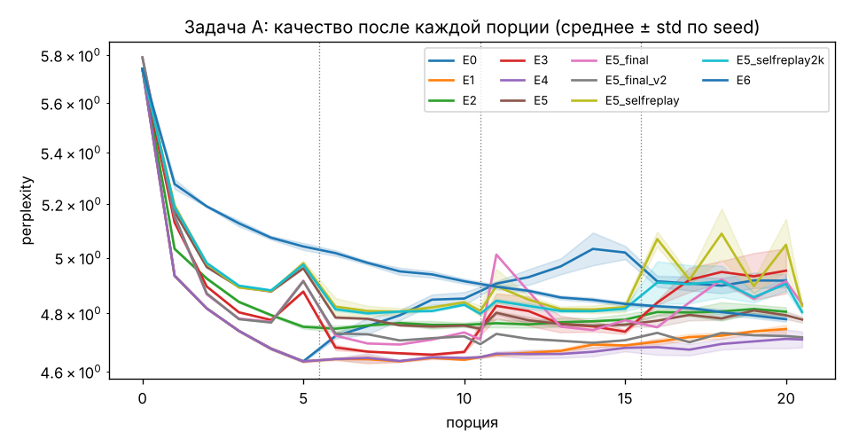
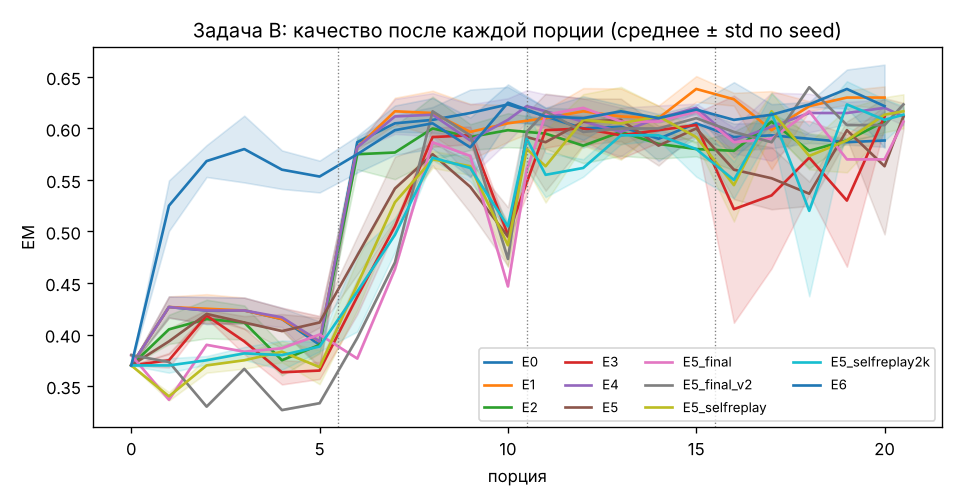
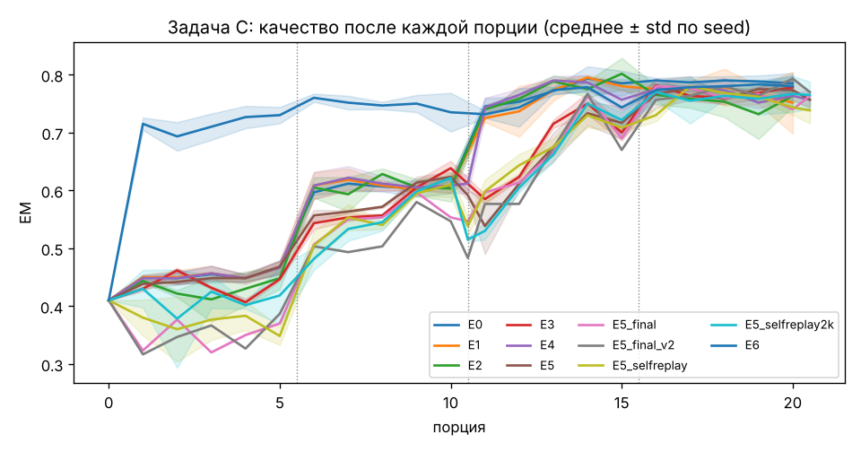
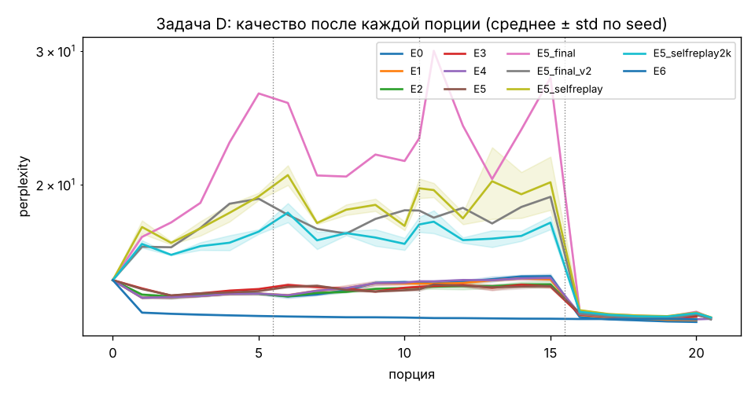
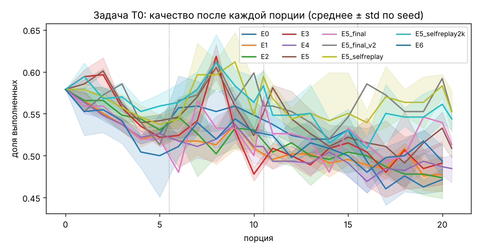
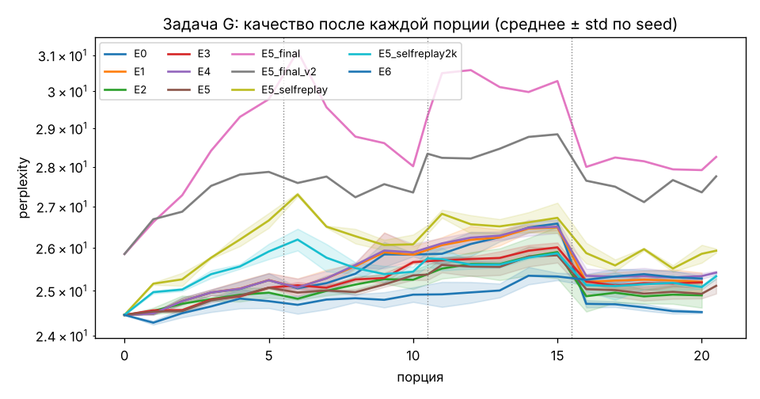
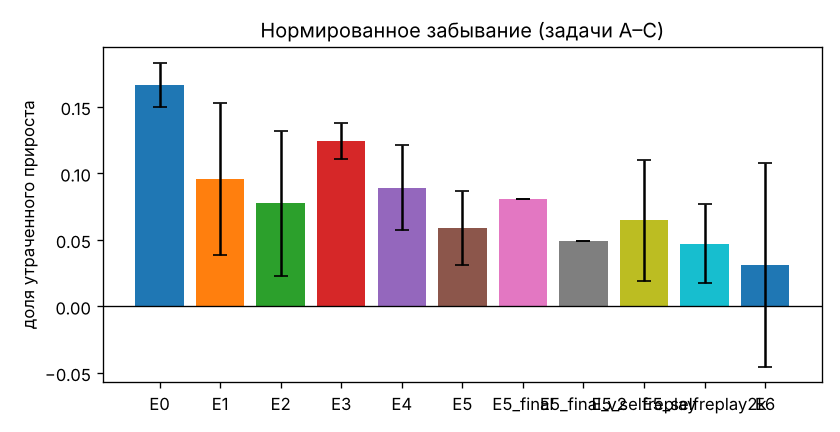

# Сводный отчёт по экспериментам

Сгенерировано `report.py` по папке с прогонами. Значения: среднее ± стандартное отклонение по seed.
Разница считается значимой, если интервалы «среднее ± std» двух конфигураций не пересекаются (правило из ТЗ).

## Проверка гипотез (черновик, требует интерпретации)

- **H1 (replay снижает забывание)**: нормированное забывание E1 = 0.096 ± 0.057, E0 = 0.167 ± 0.017 → данных недостаточно (разница в пределах разброса seed).
- **H2 (отбор по «удивлению»: то же качество за меньшее число шагов)**: шагов обучения E2 = 575 ± 0, E1 = 835 ± 0; качество на новой задаче в конце её обучения значимо хуже у E2 на задачах: A, D → не подтверждена (качество на новых задачах значимо хуже).
- **H3 (curriculum ускоряет освоение)**: средние шаги до целевого качества E3 = 137.0 ± 5.8, E1 = 78.3 ± 2.9 → не подтверждена (эффект значимо в обратную сторону).
- **H4 (фаза «сна» удерживает старые задачи)**: нормированное забывание E4 = 0.089 ± 0.032, E1 = 0.096 ± 0.057 → данных недостаточно (разница в пределах разброса seed).

## Критерий для готовой модели

- **E5**: задача 0 в конце потока = 88% от контрольной базы (± 2%, худший seed 85%); порог 90% → не выполнен.
- **E5_final**: задача 0 в конце потока = 89% от контрольной базы; порог 90% → не выполнен.
- **E5_final_v2**: задача 0 в конце потока = 95% от контрольной базы; порог 90% → выполнен.
- **E5_selfreplay**: задача 0 в конце потока = 95% от контрольной базы (± 5%, худший seed 90%); порог 90% → не выполнен.
- **E5_selfreplay2k**: задача 0 в конце потока = 94% от контрольной базы (± 3%, худший seed 91%); порог 90% → выполнен.

## Отличие от контрольной базы

Контрольная база — исходная Instruct-модель до любого обучения. В таблице — изменение качества к концу потока (конец минус база; для EM и доли выполненных инструкций — в долях, для остальных — в натах потерь с обратным знаком): плюс — лучше базы, минус — хуже. Задача 0 (T0) и общий тест (G) не обучаются, поэтому для них минус — это забывание. «Мин. T0» — худшее значение задачи 0 за весь поток относительно базы.

| Конфигурация | Δ A | Δ B | Δ C | Δ D | Δ T0 | Δ G | T0: конец / база | Мин. T0 / база |
|---|---|---|---|---|---|---|---|---|
| E0 | 0.155 ± 0.006 | 0.218 ± 0.008 | 0.375 ± 0.022 | 0.127 ± 0.001 | -0.107 ± 0.017 | -0.003 ± 0.001 | 81 ± 3 % | 78 ± 3 % |
| E1 | 0.190 ± 0.004 | 0.260 ± 0.013 | 0.342 ± 0.065 | 0.121 ± 0.002 | -0.101 ± 0.025 | -0.030 ± 0.010 | 83 ± 4 % | 80 ± 1 % |
| E2 | 0.178 ± 0.004 | 0.237 ± 0.013 | 0.353 ± 0.023 | 0.118 ± 0.001 | -0.105 ± 0.030 | -0.018 ± 0.014 | 82 ± 5 % | 78 ± 2 % |
| E3 | 0.148 ± 0.020 | 0.242 ± 0.013 | 0.368 ± 0.018 | 0.111 ± 0.001 | -0.088 ± 0.031 | -0.030 ± 0.005 | 85 ± 5 % | 78 ± 3 % |
| E4 | 0.198 ± 0.007 | 0.242 ± 0.010 | 0.347 ± 0.019 | 0.117 ± 0.003 | -0.094 ± 0.020 | -0.039 ± 0.002 | 84 ± 3 % | 80 ± 2 % |
| E5 | 0.183 ± 0.003 | 0.242 ± 0.016 | 0.347 ± 0.014 | 0.115 ± 0.000 | -0.070 ± 0.014 | -0.027 ± 0.009 | 88 ± 2 % | 83 ± 6 % |
| E5_final | 0.181 | 0.227 | 0.353 | 0.115 | -0.066 | -0.089 | 89 % | 83 % |
| E5_final_v2 | 0.205 | 0.243 | 0.360 | 0.120 | -0.026 | -0.071 | 95 % | 89 % |
| E5_selfreplay | 0.174 ± 0.003 | 0.247 ± 0.020 | 0.328 ± 0.028 | 0.113 ± 0.001 | -0.026 ± 0.030 | -0.059 ± 0.002 | 95 ± 5 % | 89 ± 8 % |
| E5_selfreplay2k | 0.178 ± 0.002 | 0.243 ± 0.010 | 0.355 ± 0.028 | 0.113 ± 0.002 | -0.035 ± 0.017 | -0.035 ± 0.003 | 94 ± 3 % | 87 ± 4 % |
| E6 | 0.183 ± 0.002 | 0.252 ± 0.049 | 0.370 ± 0.023 | 0.119 ± 0.002 | -0.086 ± 0.023 | -0.033 ± 0.003 | 85 ± 4 % | 78 ± 3 % |

## Забывание

Нормированное забывание — доля прироста качества над исходной моделью, утраченная к концу потока (0 = ничего не забыто, 1 = забыт весь прирост). Сырое забывание — лучшее качество на задаче минус качество в конце (по валидационной выборке): для EM — в долях, для LM-задач — в натах потерь.

| Конфигурация | seed | Норм. забывание (A–C) | Забывание A | Забывание B | Забывание C |
|---|---|---|---|---|---|
| E0 | 3 | 0.167 ± 0.017 | 0.059 ± 0.006 | 0.050 ± 0.013 | 0.015 ± 0.013 |
| E1 | 3 | 0.096 ± 0.057 | 0.024 ± 0.004 | 0.013 ± 0.003 | 0.048 ± 0.062 |
| E2 | 3 | 0.078 ± 0.055 | 0.013 ± 0.003 | 0.013 ± 0.025 | 0.047 ± 0.030 |
| E3 | 3 | 0.124 ± 0.014 | 0.061 ± 0.019 | 0.018 ± 0.025 | 0.005 ± 0.013 |
| E4 | 3 | 0.089 ± 0.032 | 0.016 ± 0.007 | 0.025 ± 0.018 | 0.038 ± 0.025 |
| E5 | 3 | 0.059 ± 0.028 | 0.007 ± 0.003 | 0.013 ± 0.023 | 0.035 ± 0.025 |
| E5_final | 1 | 0.081 | 0.030 | 0.013 | 0.017 |
| E5_final_v2 | 1 | 0.050 | 0.005 | 0.017 | 0.023 |
| E5_selfreplay | 3 | 0.065 ± 0.046 | 0.006 ± 0.003 | 0.013 ± 0.026 | 0.042 ± 0.028 |
| E5_selfreplay2k | 3 | 0.047 ± 0.030 | 0.002 ± 0.002 | 0.022 ± 0.006 | 0.020 ± 0.035 |
| E6 | 3 | 0.031 ± 0.077 | -0.003 ± 0.001 | 0.022 ± 0.049 | 0.012 ± 0.023 |

## Итоговое качество на тесте

| Конфигурация | A (ppl) | B (EM) | C (EM) | D (ppl) | T0 (доля выполненных) | G (ppl) |
|---|---|---|---|---|---|---|
| E0 | 5.05 ± 0.03 | 0.605 ± 0.012 | 0.802 ± 0.020 | 13.50 ± 0.00 | 0.471 ± 0.017 | 25.85 ± 0.03 |
| E1 | 4.90 ± 0.03 | 0.617 ± 0.004 | 0.786 ± 0.043 | 13.57 ± 0.01 | 0.478 ± 0.025 | 26.54 ± 0.26 |
| E2 | 4.95 ± 0.01 | 0.595 ± 0.005 | 0.771 ± 0.008 | 13.61 ± 0.01 | 0.474 ± 0.030 | 26.28 ± 0.37 |
| E3 | 5.14 ± 0.09 | 0.578 ± 0.009 | 0.782 ± 0.018 | 13.70 ± 0.01 | 0.491 ± 0.031 | 26.62 ± 0.15 |
| E4 | 4.87 ± 0.04 | 0.619 ± 0.020 | 0.796 ± 0.015 | 13.64 ± 0.04 | 0.485 ± 0.020 | 26.77 ± 0.09 |
| E5 | 4.92 ± 0.01 | 0.600 ± 0.023 | 0.765 ± 0.010 | 13.64 ± 0.01 | 0.509 ± 0.014 | 26.51 ± 0.24 |
| E5_final | 4.96 | 0.589 | 0.798 | 13.68 | 0.513 | 28.25 |
| E5_final_v2 | 4.84 | 0.598 | 0.795 | 13.60 | 0.553 | 27.75 |
| E5_selfreplay | 4.96 ± 0.01 | 0.605 ± 0.010 | 0.748 ± 0.023 | 13.68 ± 0.01 | 0.553 ± 0.030 | 27.47 ± 0.08 |
| E5_selfreplay2k | 4.94 ± 0.01 | 0.591 ± 0.010 | 0.763 ± 0.002 | 13.66 ± 0.01 | 0.544 ± 0.017 | 26.84 ± 0.13 |
| E6 | 4.91 ± 0.01 | 0.606 ± 0.016 | 0.795 ± 0.006 | 13.59 ± 0.01 | 0.493 ± 0.023 | 26.67 ± 0.09 |
| Контрольная база (до обучения, валидация) | 5.74 | 0.370 | 0.410 | 14.96 | 0.579 | 24.46 |

## Перенос вперёд и скорость освоения

Шаги до целевого качества: целевое значение для задачи — 90% прироста, который E1 набирает за время обучения на ней (по промежуточным замерам). Если цель не достигнута, ставится число шагов задачи + 1.
FWT — качество на задаче перед началом её обучения минус качество исходной модели (Lopez-Paz & Ranzato, 2017).

| Конфигурация | Ср. шаги до цели | Шаги A | Шаги B | Шаги C | Шаги D | FWT B | FWT C | FWT D |
|---|---|---|---|---|---|---|---|---|
| E0 | 76.7 ± 20.8 | 120.0 ± 0.0 | 66.7 ± 64.3 | 80.0 ± 34.6 | 40.0 ± 0.0 | 0.020 ± 0.028 | 0.197 ± 0.014 | -0.012 ± 0.008 |
| E1 | 78.3 ± 2.9 | 120.0 ± 0.0 | 46.7 ± 30.6 | 66.7 ± 23.1 | 80.0 ± 0.0 | 0.023 ± 0.030 | 0.198 ± 0.015 | -0.002 ± 0.004 |
| E2 | 73.6 ± 15.3 | 101.0 ± 0.0 | 53.3 ± 11.5 | 60.0 ± 40.0 | 80.0 ± 20.0 | 0.020 ± 0.010 | 0.193 ± 0.028 | 0.013 ± 0.012 |
| E3 | 137.0 ± 5.8 | 161.0 ± 0.0 | 120.0 ± 0.0 | 193.7 ± 23.7 | 73.3 ± 23.1 | -0.005 ± 0.010 | 0.228 ± 0.015 | 0.019 ± 0.006 |
| E4 | 83.3 ± 14.4 | 120.0 ± 0.0 | 46.7 ± 30.6 | 80.0 ± 20.0 | 86.7 ± 11.5 | 0.023 ± 0.030 | 0.202 ± 0.021 | -0.006 ± 0.008 |
| E5 | 102.1 ± 7.9 | 101.0 ± 0.0 | 93.7 ± 42.2 | 140.3 ± 0.6 | 73.3 ± 11.5 | 0.042 ± 0.006 | 0.182 ± 0.010 | 0.018 ± 0.004 |
| E5_final | 250.2 | 240.0 | 301.0 | 240.0 | 220.0 | 0.020 | 0.137 | -0.614 |
| E5_final_v2 | 200.2 | 301.0 | 140.0 | 240.0 | 120.0 | -0.047 | 0.073 | -0.252 |
| E5_selfreplay | 123.8 ± 10.5 | 141.0 ± 0.0 | 100.0 ± 34.6 | 134.0 ± 12.1 | 120.0 ± 0.0 | -0.002 ± 0.020 | 0.128 ± 0.019 | -0.294 ± 0.099 |
| E5_selfreplay2k | 120.5 ± 5.0 | 141.0 ± 0.0 | 93.3 ± 11.5 | 134.0 ± 12.1 | 113.7 ± 31.0 | 0.018 ± 0.006 | 0.105 ± 0.005 | -0.174 ± 0.024 |
| E6 | — | — | — | — | — | — | — | — |

## Эффективность по данным и стоимость

«После 1-й порции» — качество на задаче сразу после первой порции её данных (фиксированное число предложенных примеров): EM для B и C, perplexity для A и D.

| Конфигурация | A после 1-й порции | B после 1-й порции | C после 1-й порции | D после 1-й порции | Шаги обучения | Шаги сна | Время, мин | Пик памяти, ГБ |
|---|---|---|---|---|---|---|---|---|
| E0 | 4.934 ± 0.003 | 0.587 ± 0.006 | 0.745 ± 0.018 | 13.377 ± 0.003 | 640 ± 0 | 0 ± 0 | 47.1 ± 0.7 | 11.14 ± 0.02 |
| E1 | 4.934 ± 0.003 | 0.582 ± 0.003 | 0.725 ± 0.009 | 13.453 ± 0.011 | 835 ± 0 | 0 ± 0 | 53.2 ± 0.4 | 11.06 ± 0.04 |
| E2 | 5.032 ± 0.005 | 0.575 ± 0.018 | 0.740 ± 0.010 | 13.484 ± 0.016 | 575 ± 0 | 0 ± 0 | 57.8 ± 0.8 | 11.08 ± 0.13 |
| E3 | 5.130 ± 0.002 | 0.437 ± 0.021 | 0.585 ± 0.010 | 13.480 ± 0.008 | 835 ± 0 | 0 ± 0 | 57.8 ± 3.0 | 11.12 ± 0.00 |
| E4 | 4.934 ± 0.003 | 0.582 ± 0.003 | 0.743 ± 0.020 | 13.496 ± 0.051 | 835 ± 0 | 64 ± 0 | 64.4 ± 1.8 | 10.99 ± 0.08 |
| E5 | 5.171 ± 0.001 | 0.477 ± 0.023 | 0.538 ± 0.059 | 13.550 ± 0.007 | 575 ± 0 | 64 ± 0 | 61.0 ± 2.5 | 11.19 ± 0.07 |
| E5_final | 5.152 | 0.377 | 0.597 | 13.637 | 1220 | 126 | 100.1 | 11.18 |
| E5_final_v2 | 5.154 | 0.397 | 0.577 | 13.514 | 1220 | 126 | 128.8 | 11.21 |
| E5_selfreplay | 5.195 ± 0.007 | 0.448 ± 0.030 | 0.598 ± 0.025 | 13.657 ± 0.012 | 620 ± 0 | 64 ± 0 | 70.3 ± 4.2 | 11.18 ± 0.04 |
| E5_selfreplay2k | 5.188 ± 0.005 | 0.442 ± 0.048 | 0.530 ± 0.018 | 13.586 ± 0.015 | 620 ± 0 | 64 ± 0 | 78.4 ± 20.0 | 11.11 ± 0.04 |
| E6 | — | — | — | — | 640 ± 0 | 0 ± 0 | 48.8 ± 1.4 | 10.57 ± 0.08 |

## Графики

